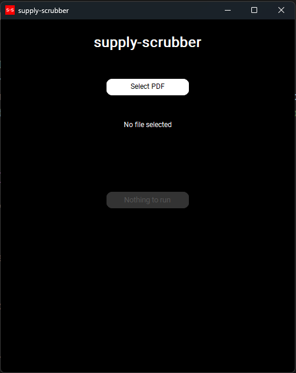
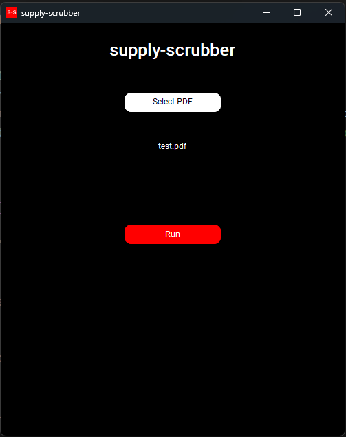
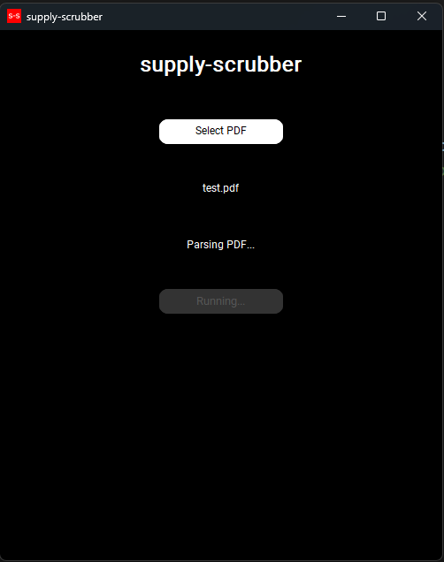
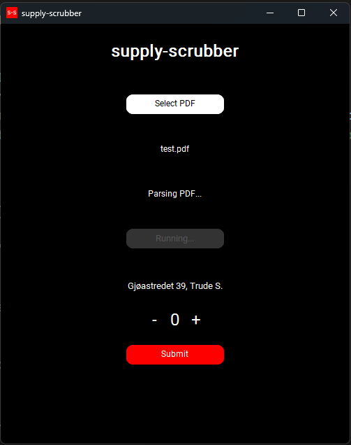
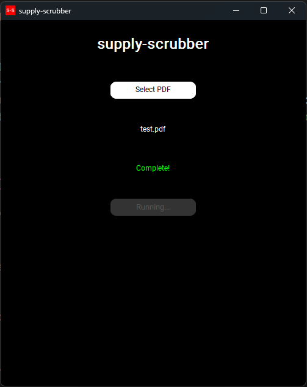
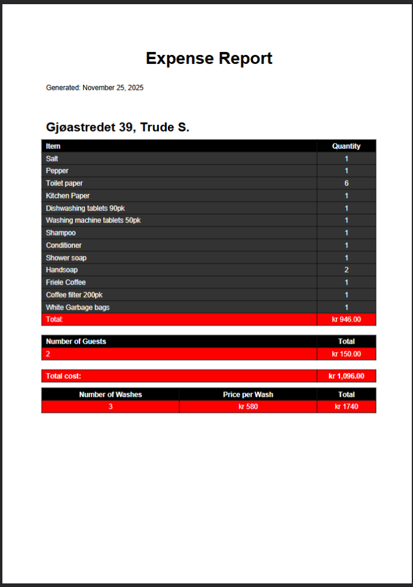

# supply-scrubber

**A desktop tool that automates monthly cost reporting for an Airbnb business by parsing custom cleaning-company PDF invoices and generating structured, accountant-ready PDF overviews.**

## Features
- Parses PDF invoices using **PyMuPDF** + **regex**
- Extracts per-apartment restocking quantities, guest counts, and dates
- Combines data with:
  - Per-apartment number of cleanings entered by the user
  - Per-apartment price lists (cleaning fees + individual supply items)
- Calculates exact costs per stay and per month
- Saves structured overviews as JSON (`washes.json`, `apartments.json`)
- Generates a clean, multi-page PDF report (one page per apartment) ready for the accountant
- Two run modes:
  - **GUI** (`python main.py`): interactive per-apartment cleaning counts via spinbox
  - **Automatic** (`python main.py --pdf <invoice.pdf>`): zero-interaction pipeline, ideal for LLM agents
- Testable pipeline with a pytest suite

## Screenshots
<div>
  
  
</div>
<div>
  
  
</div>
<div>
  
  
</div>

## Get started

1. Clone the repository:
	```bash
	git clone https://github.com/magnusapaulsen/supply-scrubber.git
 	cd supply-scrubber
 	```
  
2. Install dependencies:
	```bash
	pip install -r requirements.txt
 	```
 
    *Note:* Ensure you have Python 3.8+ installed.

3. Get price lists:
    Place your JSON price lists (`price_list_items.json` & `price_list_apartments`) inside the data folder of the project directory.
    (Example files are included)

4. Run the script:
    ```bash
    python main.py
    ```
    
5. Navigate the GUI:
    Select PDF.
    Run parsing.
    Fill in number of cleanings (arrow keys and enter work too).
    Click 'Generate PDF' once it appears.

### Automatic mode (no GUI)

To run the full pipeline on an invoice and produce the final report PDF directly:

```bash
python main.py --pdf /path/to/invoice.pdf
```

This parses the PDF, calculates totals, groups apartments, assigns one wash per parsed wash, and writes the finished PDF to `data/apartments.pdf`. No interactive input is required. This is the mode an LLM agent would use to fulfill a request like "take this invoice and use supply-scrubber to generate a PDF for my accountant."

## Testing

```bash
python -m pytest
```

The test suite covers the calculation, grouping, and finalize logic, plus PDF generation. All tests run without the GUI or a display server.
     
## Requirements
- `CTkSpinbox`
- `customtkinter`
- `pymupdf`
- `reportlab`
- `pytest` (for running the test suite)

List of dependencies is in `requirements.txt`.
